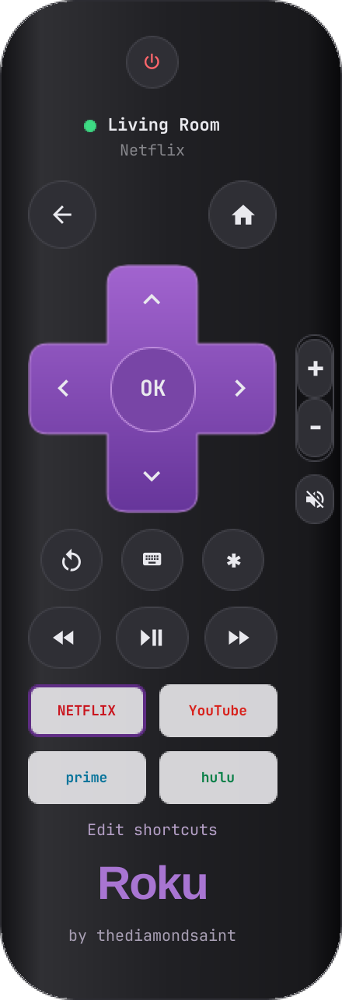

# Roku Remote for Omarchy

<p align="center"></p>

A Roku remote that looks like a real one, as a floating window for [Omarchy](https://omarchy.org)
(Hyprland + Quickshell). Keyboard- and mouse-driven, talks straight to your TV over your local network.

- Sculpted dark body, purple directional pad, round buttons, and a side volume rocker
- Four app buttons in a two-by-two layout (keys `1`-`4`; `5`-`8` also work) and a "now playing" line
- Type into the TV's on-screen keyboard from your keyboard
- Switch between several Rokus from a drop-down list (click the TV name, or press `d`)
- Bundled `roku` command-line tool (`roku home`, `roku volup*3`, `roku netflix`, ...)

## Requirements

- Omarchy with the shell plugin system (`omarchy-shell`), Hyprland, `python3`
  (developed and tested on Hyprland 0.56 with a TCL Roku TV running Roku OS 15; other models should work but are untested)
- A Roku on the same network, with **Settings > System > Advanced system settings > Control by
  mobile apps > Network access** set to **Permissive** (the default "Limited" mode ignores button presses;
  the remote shows an amber dot next to that TV's name if it detects this)

## Install

```bash
omarchy plugin add https://github.com/thediamondsaint/roku-remote --enable --yes
```

(or clone this repo into `~/.config/omarchy/plugins/charles.roku-remote/`, then
`omarchy-shell shell rescanPlugins` and `omarchy plugin enable charles.roku-remote`).

Then add the window rule and keybind from [`extras/hyprland.lua`](extras/hyprland.lua) to your Hyprland
config and run `hyprctl reload`. The window rule is what makes the remote a small floating window on the
right edge; without it the remote will tile like a normal window.

Optional, for the terminal command and TV-volume keybinds:

```bash
./install.sh     # links bin/roku to ~/.local/bin/roku
roku list        # finds Rokus on your network
roku default <name>
```

If you have several Rokus, pick yours with `roku default <name>`. The remote uses that default (`Tab` cycles TVs
while it's open, or click the name / press `d` for the list); it always opens on your default TV, and with no default set it starts on
the first Roku it finds.

The first time it opens, the remote scans your local /24 network for Rokus, which takes a few seconds; the result is
cached in `~/.cache/roku.json`. Click the TV name and choose **Rescan TVs**, press `F5`, or run `roku list` to rescan.
The remote refreshes status every five seconds while open. A scan preserves your default even if the TV is offline.
Explicit IP addresses bypass discovery, including devices outside the scanned subnet.

## Customize app shortcuts

Click **Edit shortcuts** beneath the four app buttons, or right-click a button.
Choose an app for each position and click **Save shortcuts**. The selection is saved
separately for each TV in `~/.config/roku-remote/shortcuts.json`, survives restarts,
and controls both the bottom buttons and keyboard keys `1`–`4`.
In Limited mode, the chooser uses the built-in app list until the TV allows app queries.

## Keys

| Key | Action | Key | Action |
|---|---|---|---|
| `h j k l` / arrows | D-pad | `Enter` | OK |
| `Backspace` / `b` | Back | `g` / `Home` | Home |
| `Space` | Play / pause | `,` `.` | Rewind / forward |
| `r` | Instant replay | `i` / `*` | Options |
| `+` `-` | Volume | `m` | Mute |
| `p` | Power | `t` or `/` | Type text (Esc stops) |
| `1`-`8` | Launch app | `d` | TV list (arrows + Enter, or `1`-`9`) |
| `Tab` | Next TV | | |
| `Esc` | Close | `F5` | Rescan TVs |

## Command line

```
roku list                     find Rokus (cached in ~/.cache/roku.json)
roku [-d NAME] KEY...         home up down left right select back play rev fwd volup voldown mute power ...
roku [-d NAME] type "text"    type into an on-screen keyboard
roku [-d NAME] apps           list installed apps
roku [-d NAME] launch APP     launch an app (`roku netflix` works too)
roku [-d NAME] status         power state / active app
roku default NAME             remember the default TV
```

Repeat a key with `KEY*N`, e.g. `roku down*5 select`. `NAME` is part of a device name or an IP address.

## Network inventory

```bash
roku inventory                        # rescan and print every returned field
roku inventory --json                 # structured report for all discovered Rokus
roku -d 192.168.1.50 inventory --json  # query one IP without scanning
```

This read-only tool queries device information, installed apps, the active app, and
media-player state. It preserves all returned XML fields and attributes, including
model, software version, serial number, network identifiers, and capabilities when
available. Blocked or unsupported endpoints are reported individually. It sends no
power, keypress, or launch commands. Treat exported reports as private device inventory.

Discovery covers the default interface’s local subnet, capped at its own `/24`.
It cannot guarantee discovery of sleeping TVs, other VLANs, or devices outside that
range; query their known IPs explicitly. No account passwords or reliable viewer
names are available through these queries.

## How it works

The remote uses Roku's local External Control Protocol (HTTP on port 8060) - no cloud, no account. Discovery
scans your local subnet for Rokus. Colours are fixed (the Roku look), not taken from your Omarchy theme.

## Troubleshooting

- **Amber dot next to the TV name / `403 Forbidden`:** that TV is in Limited mode and ignores button presses. Hover
  the name for the fix: set Network access to Permissive on the TV (see above). You can still switch TVs.
- **Red dot ("can't reach"):** the TV is off or on another network/VLAN.
- **Nothing found:** click the TV name and choose **Rescan TVs**, or press `F5`.
- **After editing `Remote.qml`:** run `omarchy restart shell` (plugin QML is cached).

## Creator

Made by **Charles Nardella ([@thediamondsaint](https://github.com/thediamondsaint))**.
Click the credit at the bottom of the remote to open this repository.
This is an independent community project for Omarchy.

## License

MIT - see [LICENSE](LICENSE).

## Development

Run `python3 -m unittest discover -s tests -v` for offline CLI regression tests and
`node --test tests/remote.test.cjs` for the remote’s state transitions.
Run `bash -n install.sh` to check installer syntax. Test the UI in Omarchy with a real Roku
for power, typing, app launches, TV switching, and offline recovery.
